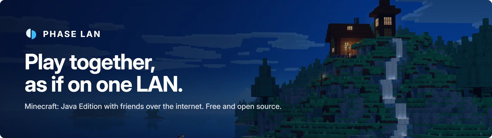
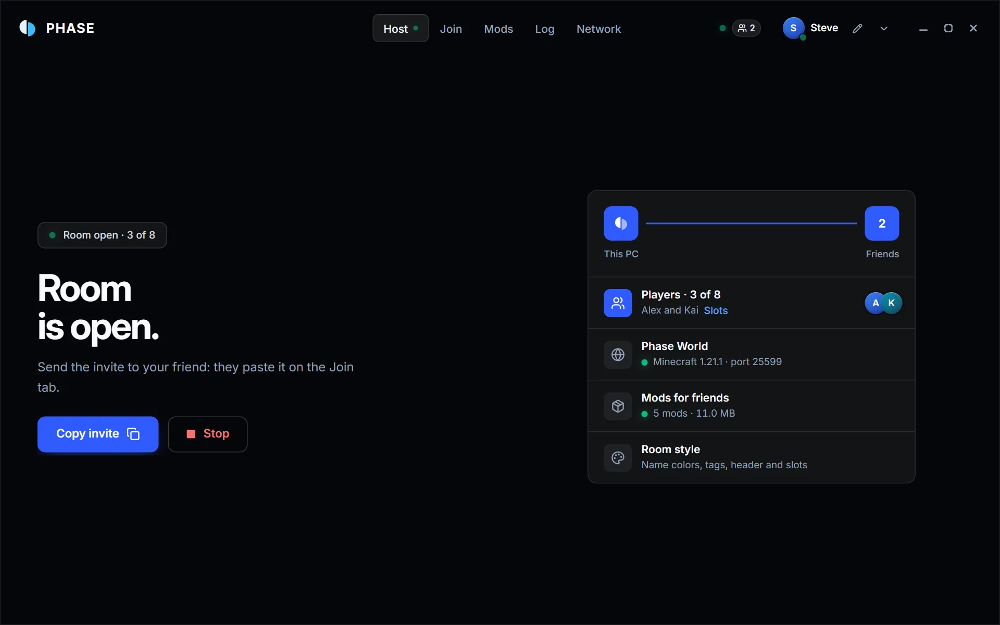
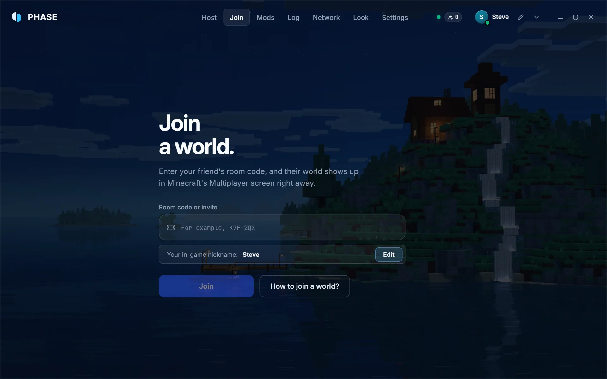
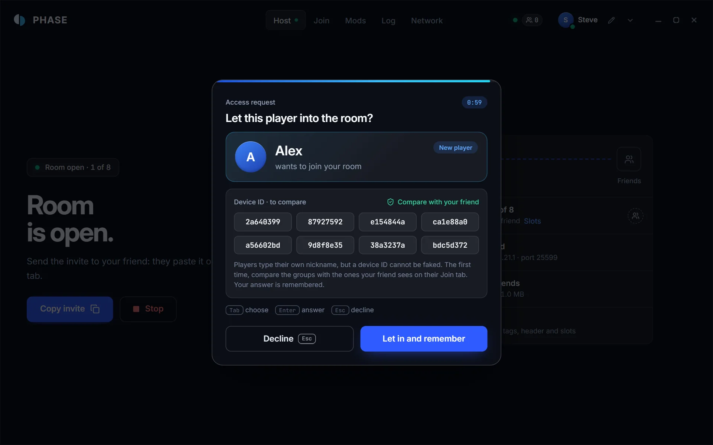
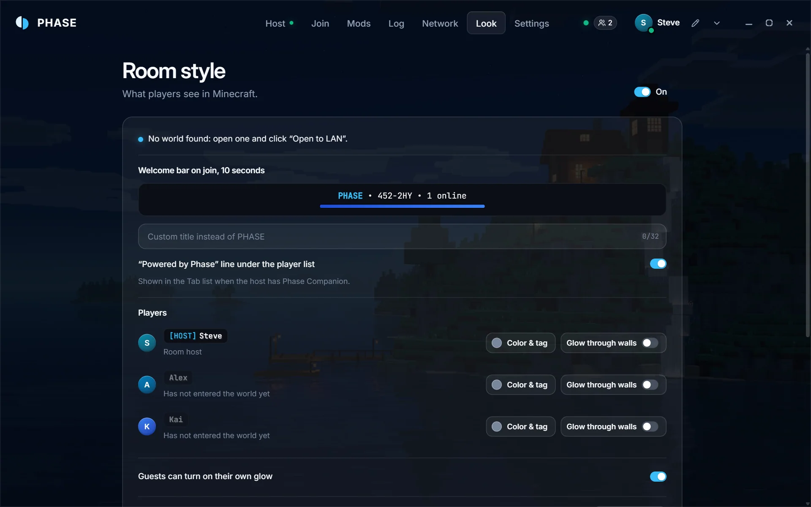
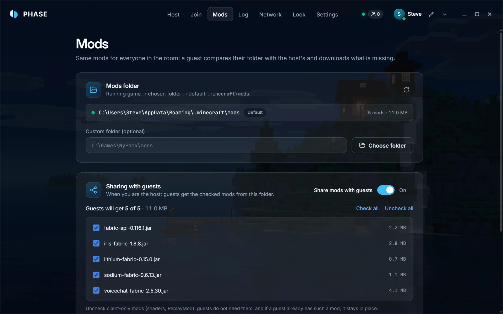

<p align="center">
  <a href="https://phase.yeskendir.com/lan/">
    <picture>
      <source media="(prefers-color-scheme: dark)" srcset=".github/assets/banner-dark.webp">
      <source media="(prefers-color-scheme: light)" srcset=".github/assets/banner-light.webp">
      
    </picture>
  </a>
</p>

<p align="center">
  <a href="https://phase.yeskendir.com/lan/download/"><b>Download</b></a>
  ·
  <a href="https://github.com/phase-mc/phase-lan/releases">Releases</a>
  ·
  <a href="https://phase.yeskendir.com/lan/safety/">Safety</a>
  ·
  <a href="README.ru.md">Русский</a>
</p>

<p align="center">
  <a href="https://github.com/phase-mc/phase-lan/actions/workflows/ci.yml"></a>
  <a href="https://github.com/phase-mc/phase-lan/releases/latest"></a>
  
  <a href="#license"></a>
</p>

Phase LAN opens your Minecraft: Java Edition world to friends over the internet. You open the world to LAN as usual, Phase creates a room, and your friend joins with a short room code. The world shows up in their *LAN Worlds* list. No port forwarding, no rented server, no accounts. Free.

Under the hood every guest gets a local stand-in server on `127.0.0.1`. Whatever the game sends there travels through an encrypted QUIC channel ([iroh](https://github.com/n0-computer/iroh)) straight to the host's game port. Phase connects the two computers directly and falls back to a relay server when NAT gets in the way.

## Screenshots

<table>
  <tr>
    <td width="50%">
      <picture>
        <source media="(prefers-color-scheme: light)" srcset=".github/assets/screenshots/room-light.webp">
        
      </picture>
      <p align="center"><b>Room.</b> Your world is open and friends are inside.</p>
    </td>
    <td width="50%">
      <picture>
        <source media="(prefers-color-scheme: light)" srcset=".github/assets/screenshots/join-light.webp">
        
      </picture>
      <p align="center"><b>Joining.</b> A friend enters the room code.</p>
    </td>
  </tr>
  <tr>
    <td width="50%">
      <picture>
        <source media="(prefers-color-scheme: light)" srcset=".github/assets/screenshots/approve-light.webp">
        
      </picture>
      <p align="center"><b>Who gets in.</b> A new player waits for the host's answer.</p>
    </td>
    <td width="50%">
      <picture>
        <source media="(prefers-color-scheme: light)" srcset=".github/assets/screenshots/look-light.webp">
        
      </picture>
      <p align="center"><b>Room look.</b> Title, colours, tags, glow and slots.</p>
    </td>
  </tr>
  <tr>
    <td colspan="2">
      <picture>
        <source media="(prefers-color-scheme: light)" srcset=".github/assets/screenshots/mods-light.webp">
        
      </picture>
      <p align="center"><b>Mods.</b> Pick the mods folder, compare it with guests and share your mods with them.</p>
    </td>
  </tr>
</table>

The nickname, world and mods in the screenshots are test data.

## Features

- **Room codes.** The host gets a short code like `K7F-2QX`; a friend types it and joins. The long invite still works as a fallback, and `phase://` links open the join screen without connecting on their own.
- **You decide who gets in.** A code is not access. Every new device waits for the host's answer, and the host sees the player's nickname and device ID. Approved devices are remembered per profile.
- **Direct first, relay if needed.** Phase tries a direct connection and falls back to a relay server through strict NAT or mobile internet. Traffic is end-to-end encrypted either way. The link comes back by itself after a short outage, and you can set your own relay in the settings.
- **Mod sync.** A guest's `mods` folder is compared with the host's by hash. Missing mods are downloaded from [Modrinth](https://modrinth.com) or, if a mod is not there, directly from the host. The guest's previous mods move to `mods\.phase-backup` and come back with one button. Fabric guests need no mods at all to join.
- **Room look.** Coloured nicknames, tags and roles, your own room title in the `Tab` header, player glow. Applied through a hidden datapack in the host's world while the room is open.
- **Up to 50 slots.** The game allows 8 players in an open LAN world. With the free [Phase Companion](https://github.com/phase-mc/phase-companion) mod (Fabric 26.3 and 1.21.1, Forge 1.21.1, NeoForge 1.21.1), installed from the Phase window, the host can set from 2 to 50 slots.
- **Voice chat.** Simple Voice Chat and Plasmo Voice work through the same channel. Phase finds their ports on the host's PC by itself.
- **Everything else.** English and Russian, dark and light themes, a tray icon, optional autostart, several profiles on one PC.

Phase LAN is free. There are no time limits, no paid slots and no ads.

## Download

Get the installer from the [website](https://phase.yeskendir.com/lan/download/) or from [GitHub Releases](https://github.com/phase-mc/phase-lan/releases). Both serve the same file, built by [GitHub Actions](.github/workflows/release.yml) from a tagged commit of this repository.

Requirements: Windows 10 or 11 (64-bit), WebView2 (part of Windows; the installer offers to add it if missing) and Minecraft: Java Edition, the same version for everyone in the room.

## Security

**Verify the file.** Each release lists the SHA-256 of `Phase-Setup-<version>.exe` in its notes and in `release.json`. Compare it in PowerShell before running the installer:

```powershell
Get-FileHash .\Phase-Setup-*.exe -Algorithm SHA256
```

If the hash does not match, do not run the file.

**Why Windows may warn you.** The installer is not code-signed yet, so SmartScreen may show "Windows protected your PC" for a new file without reputation. The warning alone does not mean the file is harmful. Check the hash, then use *More info* → *Run anyway*. See the [code signing policy](#code-signing-policy) for what we do instead and what we plan.

**What the installer does.** It installs Phase into your user folder (`%LOCALAPPDATA%\Programs\Phase`) with a shortcut and an uninstaller. No administrator rights, no bundled programs. The only download it may make is WebView2 from Microsoft, with your consent and after checking its signature.

**What Phase touches on your PC.**

| Reads | Writes | Does not |
|---|---|---|
| ports and the command line of the running game, to find the world and game folder | its own data in `%LOCALAPPDATA%\Phase` | collect analytics or telemetry |
| game logs, to find voice mod ports and your nickname | a hidden styling datapack in the host's world while a room is open | need administrator rights |
| launcher files, taking only the in-game name | mods, when you start a sync or install; extras move to `mods\.phase-backup` | install other programs |
| world names and icons, files in the `mods` folder | the `phase://` link handler, and autostart only if you turn it on | give players operator rights |

### What data goes where

Phase has no accounts, analytics or telemetry.

- **Your PC.** `%LOCALAPPDATA%\Phase` holds your device key (encrypted with Windows DPAPI), nickname, allowed devices, a mod hash cache and session reports. Nothing from it is sent to the developer.
- **Other players.** Room participants see your nickname and device ID. A direct connection reveals participants' IP addresses to each other. Guests receive the list of mods the host shares.
- **Relay servers.** If a direct connection is impossible, encrypted packets go through a relay. By default these are the public servers of the iroh project (n0); you can set your own. A relay sees device IDs, IP addresses and traffic volume, not the contents.
- **Room codes.** Without a code service of your own, the host publishes a signed record "code → room" (device ID and connection addresses) to the public pkarr network (`dns.iroh.link`) and renews it every minute. It expires about two minutes after the room closes.
- **Modrinth and GitHub.** During mod sync Phase sends a file's SHA-1 to Modrinth and may download the mod from it. Phase Companion is downloaded from GitHub when you press the install button.

To remove your data, tick the data option in the uninstaller or delete `%LOCALAPPDATA%\Phase`.

Found a vulnerability? Please report it privately, see [SECURITY.md](SECURITY.md).

## Code signing policy

**Status.** Current releases, 1.0.3 included, are not digitally signed. Until they are, verify every download yourself: check its SHA-256 as described above, look at the VirusTotal report linked from the release page and read the public build log on GitHub Actions. We plan to add a digital signature later, once the project has enough public history and users. The rules below are the policy we have adopted; they take effect as soon as a signing certificate is obtained.

**What is signed.** Only files built from this open repository, [phase-mc/phase-lan](https://github.com/phase-mc/phase-lan): the installer `Phase-Setup-<version>.exe` and the `Phase.exe` it installs. They are built exclusively by the public [release workflow](.github/workflows/release.yml) on GitHub Actions from a version tag, and its log is open to everyone. Nothing built on a personal computer is ever submitted for signing. This describes the future process: nothing is signed today.

**Roles.**

- Committers and reviewers: the [members](https://github.com/orgs/phase-mc/people) of the phase-mc organization. Changes from outside contributors go through a pull request reviewed by a member.
- Approver: **phasecompany**, the maintainer. Every signing request is approved manually by the maintainer after checking that it comes from the release workflow and the expected tag.

**Privacy.** Phase LAN does not collect analytics or telemetry. The network connections it makes and the data each one carries are listed in [What data goes where](#what-data-goes-where).

## Build from source

You need Windows 10 or 11, [Rust](https://rustup.rs) (stable, edition 2024) with the MSVC toolchain and [Node.js](https://nodejs.org) 20.19+ or 22.12+.

```powershell
git clone https://github.com/phase-mc/phase-lan.git
cd phase-lan

# Core, tunnel, relay and the console app
cargo build --release
cargo test

# The window (Tauri 2 + Svelte 5)
cd crates\gui
npm ci
npm run check          # TypeScript and Svelte
npm test               # unit tests
npm run tauri dev      # run the window in development mode
npx tauri build --no-bundle   # release build: target\release\Phase.exe
cd ..\..

# Everything, including the Rust part of the window
cargo test --workspace
cargo clippy --workspace --all-targets
```

The installer embeds a release `Phase.exe` and is built with one script. It writes `dist\Phase-Setup-<version>.exe` and `dist\release.json` with the file's SHA-256:

```powershell
powershell -ExecutionPolicy Bypass -File tools\build-setup.ps1
```

This is the same script the [release workflow](.github/workflows/release.yml) runs, so you can rebuild a release yourself and compare.

Your own relay server is `phase-relay` (`target\release\phase-relay.exe`); run it with `--help` for HTTP, HTTPS (Let's Encrypt or your own certificate) and access options.

## Project layout

| Path | What it is |
|---|---|
| `crates/tunnel` | P2P channel on iroh: device keys, access by device ID, invites, TCP/UDP forwarding, mod transfer |
| `crates/relay` | `phase-relay`, a self-hosted relay server with an optional room code service |
| `crates/codes` | Short room codes: code service client and pkarr records |
| `crates/netstat` | Windows port tables, process command lines and working folders |
| `crates/minecraft` | LAN announcements, server status, handshake, voice ports, worlds, nicknames, styling datapack |
| `crates/core` | Host and guest sessions for any front end, mod sync and Modrinth, room look, Phase Companion |
| `crates/lang` | English and Russian strings for the Rust side |
| `crates/cli` | `phase-cli`, the console app |
| `crates/gui` | The window: Tauri 2 (`src-tauri`) and Svelte 5 (`src`) |
| `crates/setup` | The installer and uninstaller |
| `tools` | Build scripts and icon generation |

The Phase Companion mod lives in its own repository: [phase-companion](https://github.com/phase-mc/phase-companion).

## Contributing

Bug reports, ideas and pull requests are welcome. Please read [CONTRIBUTING.md](CONTRIBUTING.md) first and follow the [Code of Conduct](CODE_OF_CONDUCT.md).

## License

Licensed under either of

- Apache License, Version 2.0 ([LICENSE-APACHE](LICENSE-APACHE))
- MIT license ([LICENSE-MIT](LICENSE-MIT))

at your option.

Unless you explicitly state otherwise, any contribution intentionally submitted for inclusion in this project by you, as defined in the Apache-2.0 license, shall be dual licensed as above, without any additional terms or conditions.

Phase Companion is a separate project licensed under MPL-2.0.

## Disclaimer

NOT AN OFFICIAL MINECRAFT PRODUCT. NOT APPROVED BY OR ASSOCIATED WITH MOJANG OR MICROSOFT. Phase does not sell or distribute Minecraft; you need your own copy of Minecraft: Java Edition.
