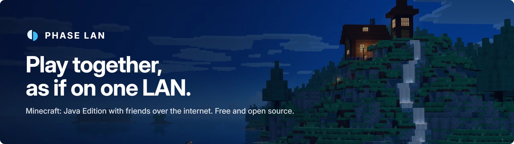

<p align="center">
  <a href="https://phase.yeskendir.com/lan/">
    <picture>
      <source media="(prefers-color-scheme: dark)" srcset=".github/assets/banner-dark.webp">
      <source media="(prefers-color-scheme: light)" srcset=".github/assets/banner-light.webp">
      
    </picture>
  </a>
</p>

<p align="center">
  <a href="https://phase.yeskendir.com/lan/download/"><b>Скачать</b></a>
  ·
  <a href="https://github.com/phase-mc/phase-lan/releases">Релизы</a>
  ·
  <a href="https://phase.yeskendir.com/lan/safety/">Безопасность</a>
  ·
  <a href="README.md">English</a>
</p>

Phase LAN открывает ваш мир Minecraft: Java Edition друзьям через интернет. Вы открываете мир для локальной сети, как обычно, Phase создаёт комнату, а друг входит по короткому коду. Мир появляется у него в списке «Локальная сеть». Без проброса портов, аренды сервера и аккаунтов. Бесплатно.

## Возможности

- **Коды комнат.** Друг вводит код вида `K7F-2QX`. Код — не доступ: каждое новое устройство ждёт ответа хоста, хост видит ник и ID устройства.
- **Сначала напрямую, при необходимости через relay.** Канал зашифрован от устройства до устройства. После короткого обрыва связь возвращается сама. Свой relay задаётся в настройках.
- **Синхронизация модов.** Папка `mods` гостя сверяется с папкой хоста по хэшам. Недостающее скачивается с Modrinth или напрямую у хоста, прежние моды гостя уходят в `mods\.phase-backup` и возвращаются одной кнопкой.
- **Оформление комнаты.** Цветные ники, теги и роли, свой заголовок в `Tab`, подсветка игроков.
- **До 50 мест** с бесплатным модом [Phase Companion](https://github.com/phase-mc/phase-companion); без мода игра пускает 8 игроков.
- **Голосовой чат.** Simple Voice Chat и Plasmo Voice работают через тот же канал.

## Скачать и проверить

Установщик — на [сайте](https://phase.yeskendir.com/lan/download/) и в [GitHub Releases](https://github.com/phase-mc/phase-lan/releases). Он собирается в GitHub Actions из этого репозитория. Перед запуском сверьте SHA-256 с указанным в релизе:

```powershell
Get-FileHash .\Phase-Setup-*.exe -Algorithm SHA256
```

Установщик пока не подписан, поэтому Windows может показать окно SmartScreen. Права администратора не нужны: Phase ставится в папку пользователя. Телеметрии и аналитики нет. Подробно о данных и сборке из исходников — в [README.md](README.md).

## Лицензия

MIT или Apache-2.0 на ваш выбор: [LICENSE-MIT](LICENSE-MIT), [LICENSE-APACHE](LICENSE-APACHE).

NOT AN OFFICIAL MINECRAFT PRODUCT. NOT APPROVED BY OR ASSOCIATED WITH MOJANG OR MICROSOFT. Phase не связан с Mojang и Microsoft.
